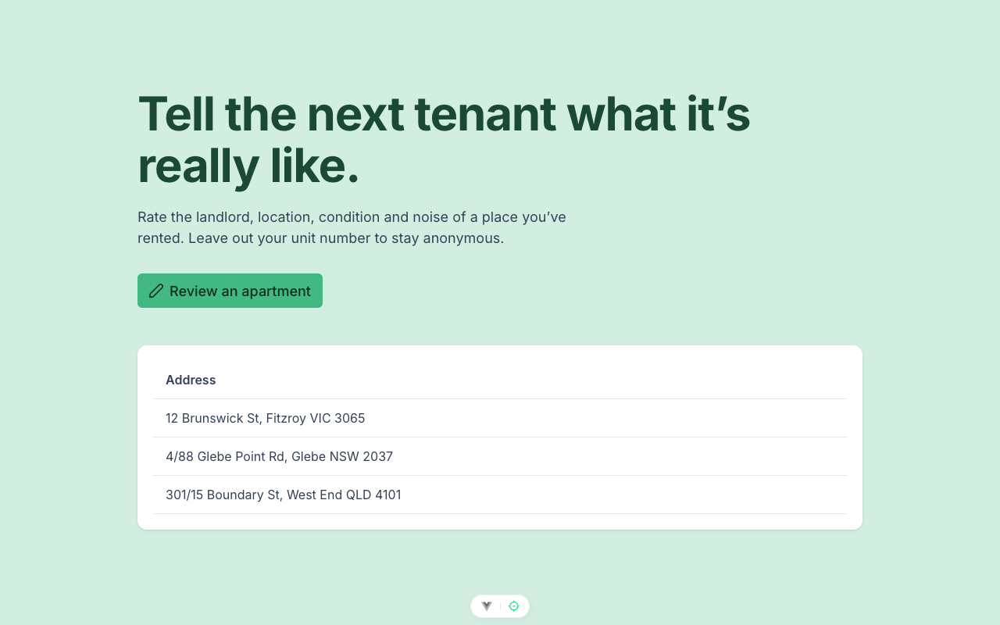

# Apartment Review

Rate the landlord, location, condition and noise of a place you've rented, so the next tenant knows what it's really like. Reviews are free to read; posting one will need an account. See [VISION.md](VISION.md) for the product thinking (anonymity, defamation, right of reply).



## Status

Early. Both halves exist and are tested, but are not wired to each other yet.

- **Frontend:** home page with the address table and the "Review an apartment" dialog: address search via OpenStreetMap, optional unit number, four 1–5 ratings, free text.
- **Backend:** `POST /user`, `POST /apartment` and a `GET /` health check over Postgres.
- **CI:** every push runs lint, tests and a Docker build for both halves (GitHub Actions).
- **Next:** deploy, then public apartment pages, Google sign-in, posting, and AI screening of every review for spam, abuse, defamation and leaked personal details before it goes live.

The full order and the reasoning behind each stage are in [roadmap.md](roadmap.md). Supporting docs: [VISION.md](VISION.md) (product thinking), [ci-cd-plan.md](ci-cd-plan.md), [next-features-plan.md](next-features-plan.md), [COMMANDS.md](COMMANDS.md) (every CLI command used here).

## Stack

| | |
|---|---|
| Frontend | Vue 3, TypeScript, Vite, PrimeVue 4, Pinia, vue-router, Vitest |
| Backend | FastAPI, SQLModel, Postgres (psycopg 3), uv, pytest, black, flake8 |
| Infra | Docker, Pulumi (TypeScript) for DigitalOcean App Platform, Cloudflare Pages and Neon Postgres |

## Layout

```
apartment-review-vue/        Vue app (src/, docker-compose.yml for the whole local stack)
apartment-review-fastapi/    FastAPI app (main.py, models.py, schemas.py, tests/)
infra/                       Pulumi program that defines the three production services
```

## Run locally

Needs Node 22 and Python 3.10 (or just Docker).

```bash
# everything: Postgres, API on :8100, frontend on :5273
cd apartment-review-vue && docker compose up

# frontend only
cd apartment-review-vue && npm ci && npm run dev

# backend only (reads DATABASE_URL, defaults to a local Postgres)
cd apartment-review-fastapi && uv sync && uv run uvicorn main:app --reload
```

## Tests

```bash
cd apartment-review-fastapi && uv run pytest
cd apartment-review-vue && npm test
```
